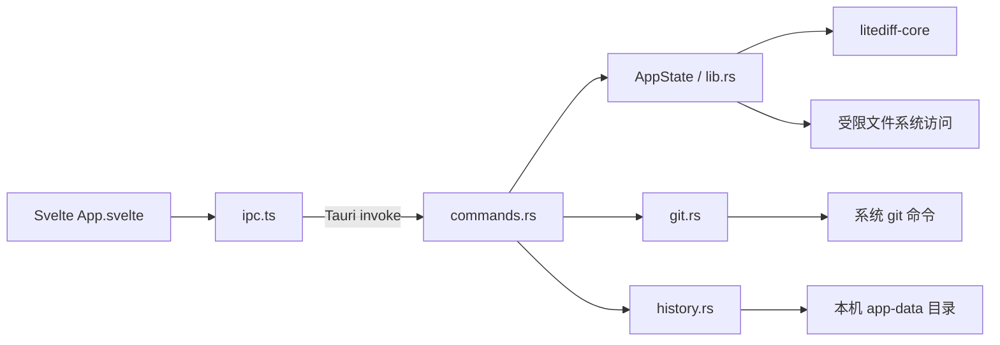

# LiteDiff 项目概览

## 1. 产品定位

LiteDiff 是一个本地优先的文本和代码差异比对桌面应用。核心目标是快速显示可靠的行级和词级差异，同时支持文件、Git 历史、比较历史和七种界面语言。

运行平台：

- macOS 11+，Apple Silicon 与 Intel。
- Windows 10/11 x64，依赖 WebView2。

## 2. 技术栈与工作区

| 层 | 技术 | 位置 |
|---|---|---|
| 差分引擎 | Rust 2021，无运行时依赖 | `crates/litediff-core/` |
| 桌面后端 | Rust、Tauri v2、Serde、Sha2 | `crates/litediff-app/` |
| 前端 | Svelte 5、TypeScript、Vite | `app/` |
| 前端测试 | esbuild 打包 + 自定义 Node runner | `app/tests/`、`app/run-tests.mjs` |
| 发布 | GitHub Actions、Tauri bundler、NSIS、DMG | `.github/workflows/release.yml`、`scripts/` |

工作区由根 `Cargo.toml` 管理，成员是 `litediff-core` 和 `litediff-app`。

## 3. 运行时架构



数据流：

1. 用户粘贴文本、拖入文件或从 Git 选择两个版本。
2. 后端读取并缓存两侧文档，建立会话 ID。
3. `litediff-core` 完成行级 Myers 比对、对齐和词级高亮。
4. 后端返回 `Session` 或省略未变化文本的 `SessionUpdate`。
5. `App.svelte` 负责视图状态、虚拟滚动、折叠、搜索、标签页和面板协调。

## 4. 关键入口

| 入口 | 责任 |
|---|---|
| `crates/litediff-core/src/lib.rs` | `diff()` / `diff_sources()` 公共入口 |
| `crates/litediff-app/src/main.rs` | Tauri 应用启动 |
| `crates/litediff-app/src/lib.rs` | `AppState`、文档能力令牌、文件读写、会话缓存 |
| `crates/litediff-app/src/commands.rs` | 全部 Tauri IPC 命令 |
| `crates/litediff-app/src/git.rs` | 只读 Git 浏览与受控分支切换 |
| `crates/litediff-app/src/history.rs` | 比较历史持久化、保留策略和校验 |
| `app/src/App.svelte` | 前端状态唯一协调层 |
| `app/src/lib/ipc.ts` | 前端到后端的唯一 IPC 封装 |
| `app/src/lib/types.ts` | 与 Rust IPC 结构对应的 TypeScript 类型 |
| `app/src/lib/viewport.ts` | 折叠、显示项、虚拟滚动和导航坐标转换 |

## 5. 不可破坏的架构约束

### 5.1 性能

- 行级 Myers 使用线性空间 bisect，峰值辅助内存应为 `O(N+M)`。
- 前端固定行高虚拟滚动，只渲染视口和 overscan 区域。
- 搜索结果最多保留 50,000 条，防止单字符查询冻结 UI。
- 单文档上限 16 MiB 和 200,000 行。
- 行级 Myers 工作预算为 25,000,000 次探测；超限时返回确定性近似结果并显示警告。
- 词级 diff 默认在 2,048 token/字符规模以上退化为整行高亮。

### 5.2 安全边界

- 渲染进程不可信。路径必须来自系统选择器、拖放授权或后端已验证的仓库根目录。
- 可写文件必须持有后端签发的 `documentId`，显示路径不等于保存能力。
- 符号链接、过期摘要、lossy UTF-8、重复路径冲突必须拒绝保存。
- Git 命令必须继续禁用 hooks、fsmonitor、外部 diff、签名展示和未受控 content filter。
- 历史记录 ID 必须限制为安全文件名字符集。

### 5.3 坐标系统

- `AlignedRow` 的源行索引。
- 分栏显示项索引。
- 统一视图物理行索引。
- 折叠后的显示索引。

任何跳转、搜索高亮、折叠和滚动恢复都必须明确使用哪套坐标，不能直接互换。

## 6. 构建与验证

首次安装：

```bash
cd app
npm ci
cd ..
```

开发：

```bash
# 终端 1
cd app && npm run dev

# 终端 2
cargo run -p litediff-app
```

完整验证：

```bash
bash scripts/verify.sh
```

Windows：

```powershell
powershell -ExecutionPolicy Bypass -File scripts\verify.ps1
```

更细的命令和门禁见 [`docs/sdd/quality-gates.md`](../sdd/quality-gates.md)。

## 7. 测试结构

- Rust 单元测试分布在各模块 `#[cfg(test)]` 中。
- 核心集成测试位于 `crates/litediff-core/tests/engine.rs`。
- 前端测试位于 `app/tests/`，覆盖视口、折叠、搜索、主题、设置、Git 树、历史、语法高亮、i18n 和性能投影。
- 当前基线：前端 330 个测试、Rust 138 个测试通过；完整结果见 `specs/changes/0001-adopt-sdd/verification.md`。

## 8. 发布

`.github/workflows/release.yml`：

- 在 `v*` 标签或手动触发时运行。
- 构建 macOS arm64、macOS x64、Windows x64。
- 生成 DMG、NSIS 安装包、便携 zip 和 `SHA256SUMS.txt`。
- 创建草稿 release，人工确认后发布。

发布改动属于高风险变更，必须走完整 SDD 路径并记录跨平台验证证据。
