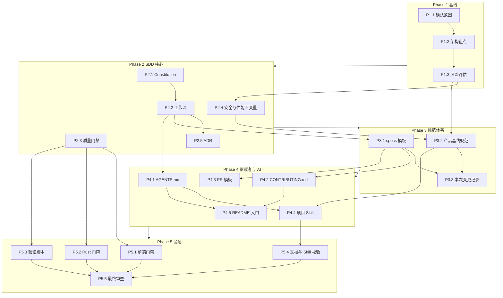

# 依赖图

## 关键路径

`确认范围 -> 架构盘点 -> 风险评估 -> 安全/性能不变量 -> 产品规范 -> 项目 Skill -> 全量验证`

## 可并行工作

- `docs/analysis/`、`docs/sdd/` 和 `specs/` 可以按不同写文件范围并行。
- 质量门禁脚本必须在 `docs/sdd/quality-gates.md` 定稿前完成并实际运行。
- README 和 PR 模板可以并行编写，但都依赖最终文档路径。
